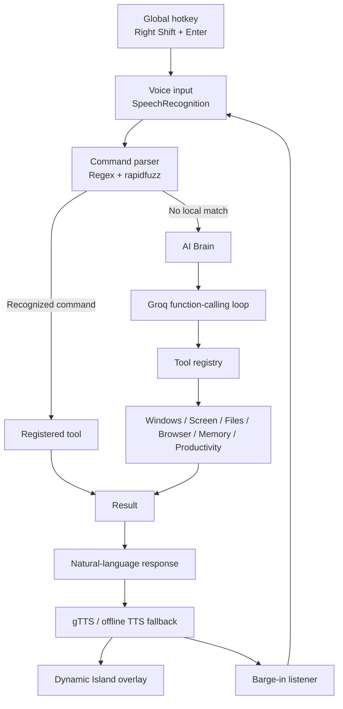

<div align="center">


# T.U.E.S.D.A.Y

### Your Windows desktop, on speaking terms.

**Tactical Unified Electronic Systematic Digital Assistant**

A voice-activated AI desktop assistant for Windows, combining natural Hinglish conversations, system automation, persistent memory, browser and file operations, productivity tools, and a minimal Dynamic Island-style interface.


-F55036?style=for-the-badge)


</div>

---

## Why this exists

A desktop assistant should do more than answer questions. It should understand a request, interact with the operating system, work with files and applications, remember useful context, and get out of the way when it is not needed.

T.U.E.S.D.A.Y is a lightweight, voice-first Windows assistant built around that idea. It combines a fast local command parser for common actions with a Universal LLM AI agent (supporting Groq, OpenAI, OpenRouter, DeepSeek, and local Ollama/LM Studio models) for requests that need reasoning or multiple tools. Its interface is a floating Dynamic Island-style overlay, while its speech layer delivers **Real-Time Streaming Neural Speech** via Microsoft Edge-TTS with Indian English and Hindi support.

The interaction loop is designed to stay simple:

```text
Press Right Shift + Enter
        -> Speak naturally
        -> Parse a direct command or ask the AI agent
        -> Execute approved tools
        -> Hear the response stream instantly (~0.3s)
        -> Interrupt speech whenever needed
```

Common commands are handled locally without an LLM round trip. More complex requests can use the agent's tool-calling loop, allowing it to combine system, screen, file, browser, memory, and productivity capabilities.

## What it provides

| Capability | Description |
|---|---|
| Voice interaction | Continuous speech input with real-time streaming neural speech (~0.3s start) |
| Local command routing | Regex-based command parser with fuzzy application matching |
| Universal AI agent | Multi-provider LLM support (Groq, OpenAI, OpenRouter, DeepSeek, Ollama, LM Studio) |
| Windows automation | Application control, window management, volume, media, and desktop actions |
| Screen understanding | Dual-engine Python OCR (winocr + RapidOCR), on-screen text search and clicking |
| File operations | Search, read, create, move, rename, compress, and undo supported file actions |
| Browser automation | Chromium navigation and interaction through Playwright |
| Persistent memory | SQLite-backed facts, conversation turns, reminders, todos, and notes |
| Semantic retrieval | ChromaDB-based search over past conversations and indexed documents |
| Productivity | Reminders, routines, daily briefings, and optional Google Workspace integration |
| Floating interface | PyQt5 Dynamic Island overlay with animated status and audio visualization |
| Safety controls | Confirmation gates for high-risk actions, audit logs, and an undo journal |

## Features

### Voice assistant and conversation

- Activate the assistant globally with `Right Shift + Enter`.
- Continuous listening supports multi-turn interaction until the configured silence period is reached.
- Speech recognition is configured for Indian English (`en-IN`) and Hindi (`hi-IN`).
- **Real-Time Streaming Neural TTS**: Responses stream sentence-by-sentence via Microsoft Edge-TTS (`en-IN-NeerjaNeural`, `hi-IN-SwaraNeural`), dropping time-to-first-word to ~0.3s.
- Automatic online fallback to `gTTS` and offline fallback to local Windows `pyttsx3`.
- **Strict No-Emoji & Tight Cadence**: Spoken replies filter out all emojis and compress ellipses to eliminate awkward audio pauses.
- Barge-in listening allows speech playback to be interrupted instantly with phrases such as `Tuesday stop`, `Tuesday chup`, `Tuesday ruko`, or `Tuesday sun`.

### Local command parser and AI agent

- A table-driven regex parser handles supported commands without waiting for an LLM.
- **Conversational Speech Normalizer**: Automatically cleans wake words (`Tuesday`), conversational hooks (`bhai`, `yaar`, `suno`, `ek kaam karo`), and politeness tags (`please`, `na`, `kar do`) so commands spoken inside natural dialogue execute locally with zero latency.
- `rapidfuzz` improves application-name matching.
- **Dynamic Tool Injection & Chatbot Mode**: Pure conversational questions (*"tell me a joke"*, *"who was Einstein?"*) bypass tool schemas entirely (`tools=None`), dropping token consumption by 95% and boosting response speed. Tool schemas are dynamically attached only when action/tool intent is detected.
- The AI brain uses function calling to select and execute registered tools when complex automation is required.
- Multi-step tool calls can be chained for requests that require more than one operation.
- The model fallback chain helps handle rate limits by moving to another available model.
- Tool results are converted into a natural-language response rather than exposing raw tool-call data.

### Windows automation and diagnostics

- Launch, close, and focus desktop applications.
- Control system volume, mute state, and media playback.
- Snap, maximize, minimize, and switch windows.
- Create, close, and navigate virtual desktops.
- Open supported Windows Settings pages.
- Capture screenshots and control Windows Game Bar screen recording.
- Inspect CPU, memory, disk, battery, network, and process information.
- Organize desktop files into categories, with a reversible operation recorded in the undo journal.
- Perform supported memory-cleanup operations.

### Screen understanding and UI automation

- Inspect the active window, PID, and process information.
- **Dual-Engine Python OCR**: Local text recognition powered by hardware-accelerated `winocr` (Windows Media OCR) and deep learning `rapidocr-onnxruntime`.
- **Visual On-Screen Text Search & Click**: Find the exact (X, Y) pixel coordinates of any visible button, tab, link, or label and click it directly via PyAutoGUI.
- **Spatial UI Layout Analysis**: Capture the desktop, map on-screen UI text elements with coordinates, and feed the live visual state to the LLM agent to reason and act.
- Read selected text while preserving the existing clipboard contents.
- Enumerate accessible window controls with `pywinauto`.
- Apply safety checks to potentially destructive or sensitive UI actions.

### Files, documents, and knowledge retrieval

- Search configured folders for files.
- Read supported text and code files.
- Extract text from PDF and Word documents.
- Summarize document content through the AI agent.
- Create files and parent directories.
- Move and rename files, with supported operations recorded for undo.
- Compress directories into ZIP archives.
- Open files using their Windows default application.
- Index folders into the document knowledge collection.
- Ask questions against indexed documents using semantic retrieval.

### Browser automation

- Open a Chromium browser session with a persistent profile.
- Navigate to URLs and search the web.
- Click supported links and page elements.
- Fill fields and submit ordinary search forms.
- Extract readable page text.
- Capture browser screenshots.
- Download files to the Downloads folder.
- Close the browser session and release its resources.
- Block supported payment and checkout actions in the browser automation layer.

### Memory and productivity

- Store and retrieve user facts in SQLite.
- Search prior conversation content semantically with ChromaDB.
- Add, list, read, complete, and delete to-do items.
- Create, list, and delete reminders.
- Save and retrieve persistent notes.
- Create and run named routines such as study or focus workflows.
- Generate a daily briefing containing configured weather, reminders, tasks, headlines, and India-related information.
- Optionally read and create Google Calendar events.
- Optionally inspect unread Gmail messages and create email drafts. Sending an email is not part of the draft operation.

### Dynamic Island overlay

- Floating PyQt5 capsule interface for assistant status and response text.
- Smooth position interpolation for movement.
- Multi-layer animated waveform visualization during speech.
- Capsule sizing adapts to short, medium, and long text.
- Text and waveform rendering are clipped to the rounded overlay boundary.

## Quick start

### Requirements

- Windows 10 or Windows 11
- Python 3.10 or newer
- A working microphone and audio output device
- Internet connection for Groq-powered conversations and online services
- A Groq API key for AI conversation and tool-calling features

Some capabilities depend on Windows APIs, installed applications, optional services, and their corresponding configuration.

### Clone the repository

```bash
git clone https://github.com/iabhnv19/T.U.E.S.D.A.Y.git
cd T.U.E.S.D.A.Y
```

Replace the repository URL above if the project is hosted under a different GitHub repository name.

### Install dependencies

```bash
python -m pip install -r requirements.txt
```

### Configure environment variables

Create your local `.env` file from the example:

```bash
copy .env.example .env
```

Open `.env` and add your Groq API key:

```env
GROQ_API_KEY=gsk_your_groq_api_key_here
```

Do not commit `.env` or publish API keys. The `.env.example` file is intended to contain placeholders only.

### Run T.U.E.S.D.A.Y

```bash
python main.py
```

Press **`Right Shift + Enter`** to activate listening.

## Configuration

The following settings are documented by the project:

| Variable | Default | Description |
|---|---|---|
| `GROQ_API_KEY` | Not set | API key used for Groq-powered AI conversations |
| `LLM_PROVIDER` | `groq` | Active AI provider (`groq`, `openai`, `openrouter`, `deepseek`, `ollama`, `lmstudio`) |
| `LLM_API_KEY` | Not set | Universal API key for the selected AI provider |
| `LLM_MODEL` | Provider default | Default model (e.g. `openai/gpt-oss-120b`, `gpt-4o-mini`, `llama3.2`) |
| `TTS_ENGINE` | `edge-tts` | Primary voice engine (`edge-tts`, `gtts`, `pyttsx3`, `auto`) |
| `EDGE_VOICE_EN` | `en-IN-NeerjaNeural` | Microsoft Neural voice for English / Hinglish speech |
| `EDGE_VOICE_HI` | `hi-IN-SwaraNeural` | Microsoft Neural voice for Hindi speech |
| `ASSISTANT_NAME` | `T.U.E.S.D.A.Y` | Assistant display name |
| `HOTKEY_MODIFIER` | `right shift` | Modifier used by the global activation shortcut |
| `HOTKEY_KEY` | `enter` | Key used with the modifier to activate listening |
| `VOICE_LANGUAGE` | `en-IN` | Speech recognition language tag |
| `WEATHER_CITY` | `Amritsar` | Default city for weather requests |

Additional optional integrations, including Google Workspace, are controlled through project configuration. Check `core/config.py` and `.env.example` for the current supported environment settings.

## Common voice commands

The assistant supports a broad command set. These examples cover frequently used actions; the complete capability and tool mapping is documented in [`TUESDAY_INDEX.md`](./TUESDAY_INDEX.md).

| Category | Example command | Action |
|---|---|---|
| Clipboard | "Make this professional" | Rewrites clipboard text into polished English |
| Clipboard | "Summarize clipboard" | Summarizes copied text |
| Clipboard | "Translate to Hindi" | Translates clipboard content |
| Diagnostics | "System diagnostics" | Reports system health and resource usage |
| Diagnostics | "Clean RAM" | Runs the supported memory-cleanup operation |
| Network | "What's my IP" / "Check ping" | Reports network information and latency |
| Desktop | "Clean my desktop" | Organizes loose desktop files |
| Screen | "What's on my screen" / "Analyze screen" | Maps spatial screen layout via OCR and explains/reasons |
| Screen | "Find text Submit on screen" | Locates visual element coordinates via local OCR |
| Screen | "Click text Save on screen" | Clicks element center using OCR-guided coordinates |
| Screen | "Read screen text" | Extracts on-screen text with layout preservation |
| Screen | "Take a screenshot" | Captures the desktop |
| Screen | "Start screen recording" | Starts Windows Game Bar recording |
| Windows | "Snap left" / "Snap right" | Snaps the active window |
| Windows | "New desktop" | Creates a virtual desktop |
| Apps | "Open Chrome" | Launches an application |
| Media | "Pause" / "Next track" | Controls media playback |
| Search | "Google search Python tutorial" | Opens a Google search |
| Files | "Search files for invoice" | Searches configured folders |
| Files | "Read PDF [path]" | Extracts PDF text |
| Browser | "Open browser to [URL]" | Opens a page in the automation browser |
| Memory | "Remember that ..." | Stores a user fact |
| Productivity | "Remind me to ... in 10 minutes" | Creates a reminder |
| Productivity | "Add todo ..." | Adds a task |
| Productivity | "Daily briefing" | Generates the configured daily briefing |

## Architecture

T.U.E.S.D.A.Y uses a hybrid command architecture. The local parser handles recognized commands directly, while the AI agent handles requests that need language understanding, reasoning, or a sequence of tools.



### Main responsibilities

| Component | Responsibility |
|---|---|
| `main.py` | Application entry point, Qt application lifecycle, global hotkey, listening and barge-in coordination |
| `core/config.py` | Environment loading, central configuration, and assistant system prompt |
| `core/brain.py` | AI agent loop, Groq model selection/fallback, tool orchestration, and memory integration |
| `core/memory.py` | SQLite persistence and ChromaDB-backed semantic memory |
| `core/scheduler.py` | Background reminder scheduler |
| `core/tools.py` | Decorator-based tool registry, schemas, safety gate, confirmation manager, and undo journal |
| `core/voice.py` | Speech recognition, language handling, text-to-speech, and audio playback |
| `modules/command_parser.py` | Local regex command routing and fuzzy application matching |
| `modules/registered_tools.py` | Core registered tools for Windows, utilities, web search, and diagnostics |
| `modules/screen_tools.py` | Screen inspection, OCR, active-window information, and UI automation |
| `modules/file_tools.py` | File operations, document extraction, indexing, and retrieval |
| `modules/browser_tools.py` | Playwright browser automation |
| `modules/productivity_tools.py` | Reminders, tasks, notes, routines, briefing, and optional Google integration |
| `modules/pc_control.py` | Windows application, window, media, volume, and system controls |
| `modules/web_search.py` | Keyless weather, news, and Wikipedia lookup helpers |
| `modules/utilities.py` | Standalone utility functions |
| `modules/overlay.py` | PyQt5 Dynamic Island interface and waveform rendering |

## Safety, confirmations, and audit logs

Desktop automation can change files and system state, so tool execution is not treated as an unrestricted command pipe.

- Tools have risk classifications.
- High-risk operations require explicit user confirmation before execution.
- Confirmation can be accepted or denied in the following interaction.
- Executed tool calls are recorded in `logs/actions.jsonl`.
- Reversible file and desktop operations are tracked in `logs/undo_journal.json`.
- Supported undo commands can restore recorded file moves, renames, and desktop organization operations.
- Browser automation includes safeguards for payment and checkout actions.

These controls reduce accidental execution, but they do not replace reviewing a command before approving it.

## Memory and local data

T.U.E.S.D.A.Y stores its runtime data locally in the project directories:

| Location | Purpose |
|---|---|
| `memory/tuesday.db` | SQLite database for facts, conversation turns, reminders, todos, and notes |
| `memory/chroma_db/` | Persistent ChromaDB vector store |
| `memory/routines.json` | User-defined automation routines |
| `memory/conversation_history.json` | Legacy conversation history, migrated to SQLite |
| `memory/user_profile.json` | Legacy user facts, migrated to SQLite |
| `logs/actions.jsonl` | Tool execution audit history |
| `logs/undo_journal.json` | Reversible operation history |

The project index documents a ChromaDB embedding configuration using `all-MiniLM-L6-v2`. Runtime databases, logs, user profiles, credentials, and other generated data should remain local and should not be committed to the repository.

## Project structure

```text
T.U.E.S.D.A.Y/
├── .env                         # Local credentials and runtime settings; do not commit
├── .env.example                 # Safe environment variable template
├── .gitignore
├── requirements.txt             # Python dependencies
├── pytest.ini                   # Pytest configuration
├── README.md
├── TUESDAY_INDEX.md             # Detailed architecture and capability reference
├── main.py                      # Application entry point and orchestrator
│
├── core/
│   ├── config.py                # Configuration and system prompt
│   ├── brain.py                 # AI agent and tool-calling loop
│   ├── memory.py                # SQLite and ChromaDB memory
│   ├── scheduler.py             # Background reminder scheduler
│   ├── tools.py                 # Tool registry and safety mechanisms
│   └── voice.py                 # Speech recognition and speech output
│
├── modules/
│   ├── registered_tools.py      # Core registered tools
│   ├── screen_tools.py          # Screen analysis, OCR, and UI automation
│   ├── file_tools.py            # File handling, documents, and RAG
│   ├── browser_tools.py          # Playwright browser automation
│   ├── productivity_tools.py    # Productivity and Google integrations
│   ├── pc_control.py             # Windows automation
│   ├── command_parser.py        # Local command parser
│   ├── web_search.py             # Weather, news, and knowledge lookup
│   ├── utilities.py              # Utility helpers
│   └── overlay.py                # Dynamic Island UI
│
├── logs/                         # Runtime audit and undo logs
├── memory/                       # Local databases and persistent assistant data
└── tests/
    ├── test_phase1.py            # Core tools, schemas, agent, safety, parser
    ├── test_phase3.py            # Memory and semantic search
    ├── test_phase456.py          # Screen, file, RAG, and browser tests
    └── test_phase7.py            # Productivity and Google integration tests
```

## Development and testing

Run the test suite from the repository root:

```bash
python -m pytest tests/ -v
```

Start the assistant:

```bash
python main.py
```

The architecture index also documents direct tool-execution examples for development:

```bash
python -c "from core.tools import execute_tool; print(execute_tool('get_active_window', {}))"
python -c "from core.tools import execute_tool; print(execute_tool('search_files', {'query': 'invoice'}))"
python -c "from core.tools import execute_tool; print(execute_tool('browser_close', {}))"
```

Some tests exercise Windows-specific functionality or optional integrations. Their results may depend on the host environment and installed services.

## Tech stack

| Technology | Purpose |
|---|---|
| Python | Application logic and orchestration |
| PyQt5 | Floating desktop overlay |
| Groq API | LLM inference and function calling |
| SpeechRecognition | Microphone input and speech-to-text |
| gTTS | Online text-to-speech |
| pygame | Audio playback |
| pyttsx3 | Offline text-to-speech fallback |
| SQLite | Structured persistent storage |
| ChromaDB | Semantic memory and document retrieval |
| Playwright | Browser automation |
| pywinauto | Windows UI automation |
| psutil | System and process telemetry |
| PyAutoGUI / pywin32 | Desktop and Windows automation |
| rapidfuzz | Fuzzy command and application matching |
| pytest | Automated testing |

## Troubleshooting

<details>
<summary><strong>Groq requests fail or return rate-limit errors</strong></summary>

Check that `GROQ_API_KEY` is present in `.env` and that the key is valid. The agent has a model fallback mechanism for rate limits, but all available models can still be unavailable or restricted by account limits.

</details>

<details>
<summary><strong>The global hotkey does not activate the assistant</strong></summary>

Confirm that the application is running and that the configured modifier and key match `HOTKEY_MODIFIER` and `HOTKEY_KEY`. Check whether another application or utility is intercepting the shortcut.

</details>

<details>
<summary><strong>Speech recognition cannot hear me</strong></summary>

Check the Windows microphone input device, microphone permissions, and input volume. Speech recognition may also require a working network connection depending on the configured recognizer.

</details>

<details>
<summary><strong>There is no spoken response</strong></summary>

Check the selected Windows output device and system volume. Verify that the audio dependencies installed successfully. The project documents gTTS playback and a `pyttsx3` offline fallback.

</details>

<details>
<summary><strong>Browser automation cannot start</strong></summary>

Check the Playwright installation and browser availability. Install the required Playwright browser runtime if it is not present in the environment:

```bash
python -m playwright install chromium
```

</details>

<details>
<summary><strong>Google Calendar or Gmail features are unavailable</strong></summary>

These integrations are optional and require their corresponding configuration and Google OAuth setup. They are not required for the core local assistant workflow.

</details>

## Known limitations

- T.U.E.S.D.A.Y is designed for Windows and relies on Windows-specific APIs and automation libraries.
- AI conversations and several online services require internet access.
- Groq availability, model limits, and API behavior can change independently of the project.
- Screen analysis, OCR, and UI automation depend on the active application and accessible controls.
- Browser automation behavior can vary across websites and their layouts.
- Google Workspace functionality requires optional OAuth configuration.
- Hardware telemetry and system-control behavior may vary by Windows version and permissions.

## Contributing

Contributions, bug reports, and feature requests are welcome. Please keep changes focused, avoid committing credentials or generated runtime data, and include tests for changes to core behavior.

## Developer

<div align="center">

<a href="https://github.com/iabhnv19">
  
  <br />
  Abhinav
  <br />
  @iabhnv19
</a>

<br />

**Built with Python to make desktop automation feel like a conversation.**

</div>
